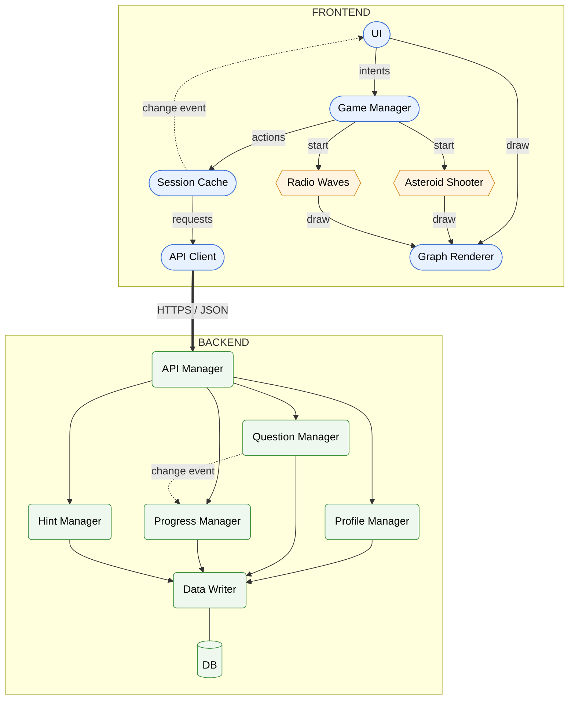
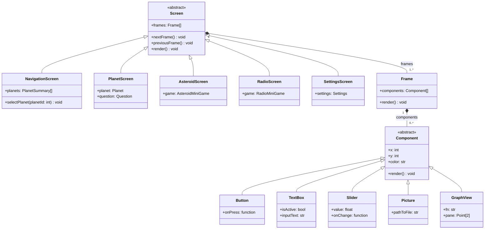
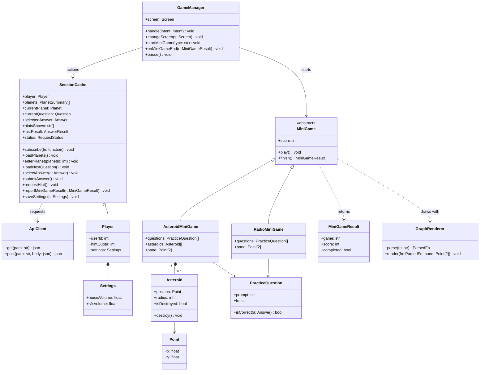
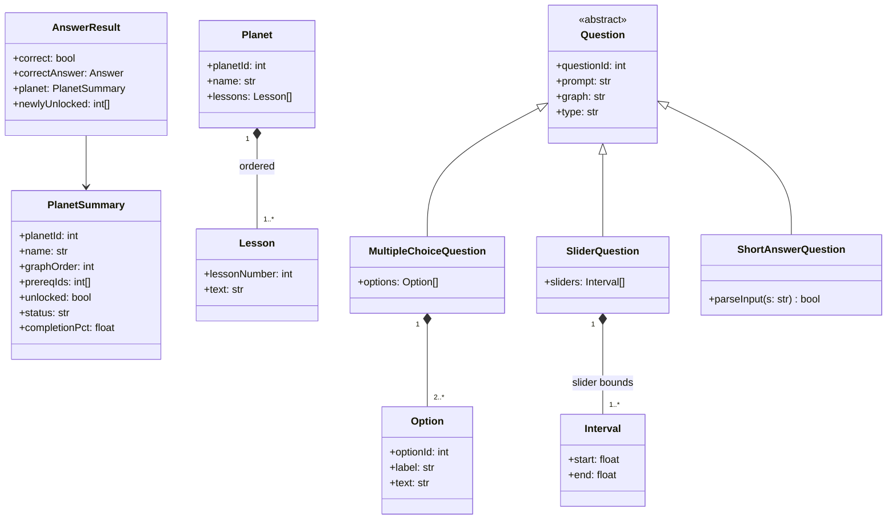
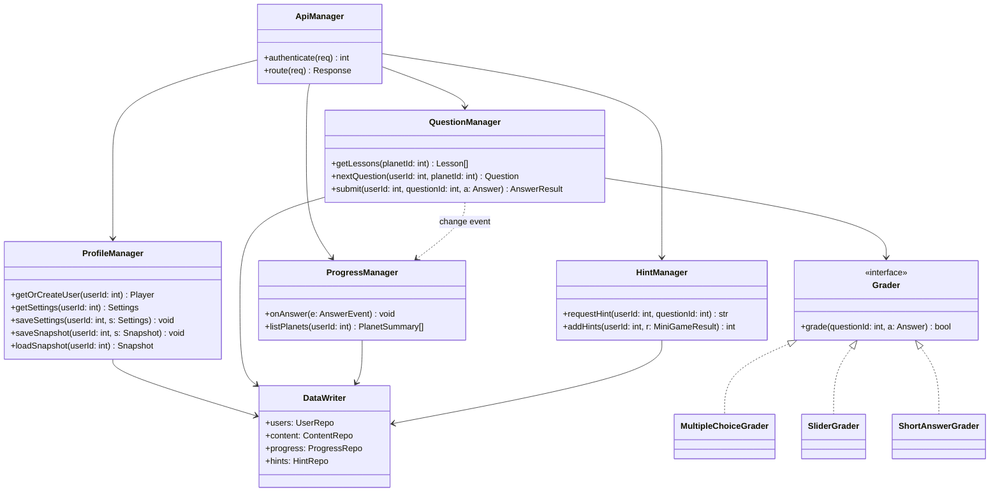
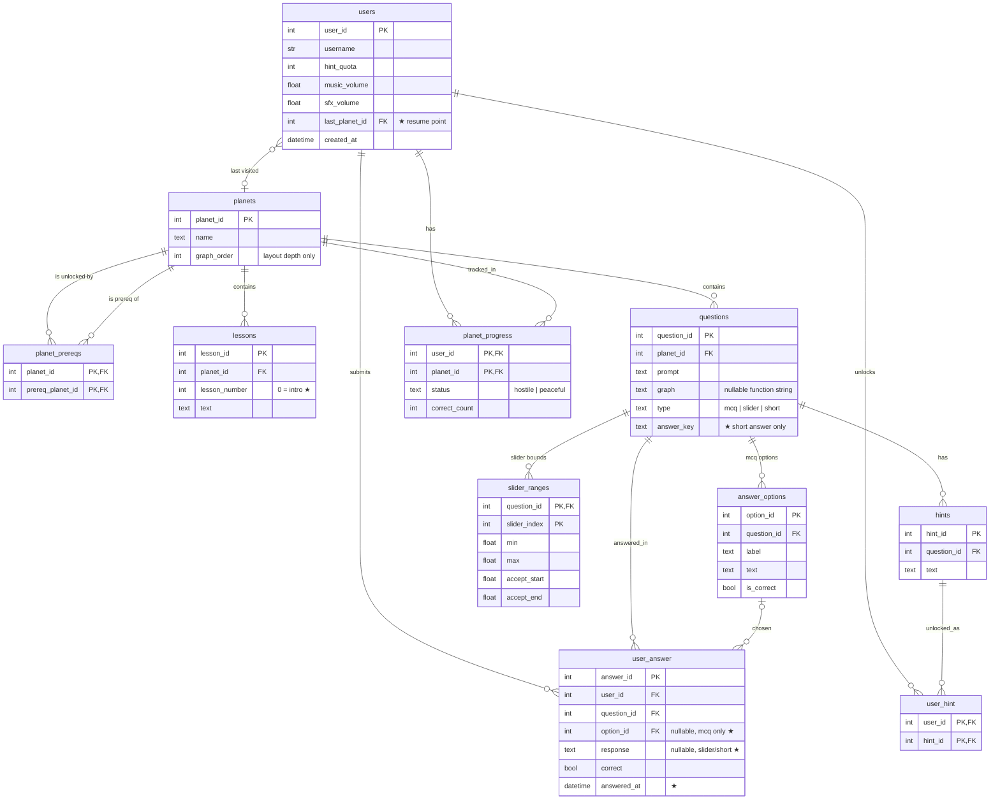
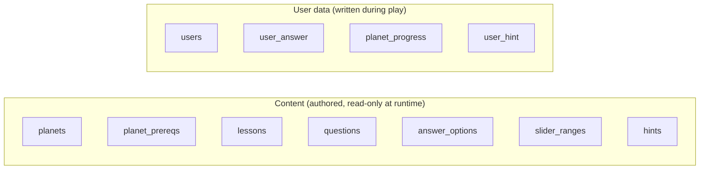

# Consolidated Architecture
also consider changing the name of these so it's not manager manager manager
## FRONTEND
#### UI
- Calls **Graph Renderer** to draw graphs
- Renders screens, planet select (laid out by graph_order), intro and lessons, question, hints, mini-games, settings
- Captures user input, turns it into intents (i.e. selectanswer, nextpage) and sends it to **Game Manager**
- Redraws from **Session Cache**'s change event
#### GAME MANAGER
- Enforces rules, i.e. no submit without a selection, no double submit, hint quota 0, etc.
- Handles the flow of the game: switching between screens, pause, what follows a result (i.e. next question, planet cleared, return to planet select)
- Starts minigames, handles minigame results, early exits, passes result to **Session Cache** 
- Does NOT call **API Client**, store data, or draw

#### SESSION CACHE
- Holds the user data (settings, hint quota, completion), the current planet and planet status, the lesson pages for the planet, the current question and question options, the selected option, the hints revealed for this question, the last result, and the progress map
- Handles actions. When a user wants to do `action`, **Session Cache** will call the necessary functions. 
    - EX: The user wants to `loadNextQuestion`. **Session Cache** will call the API Client, store the reply, clear the old selection, and publish a change event.
    - EX: Other actions may include `submit answer`, `fetch hint`, `report minigame results`, `load progress`, `save settings`
- Calls **API Client** for each action (or optionally at a save point) and writes the reply into itself
- (OPTIONAL) Tracks request status so the UI can show a spinner or retry
- Enforces rules regarding data: selected option belongs to current question, quota never negative, etc
- Publishes change event, produces and restores snapshots

#### API CLIENT
- Makes HTTPS/JSON requests for necessary actions and parses replies
- Attaches the user identity
- Handles timeouts, retries, and typed errors
- Does NOT have game logic

#### ASTEROID SHOOTER
- yay minigame

#### RADIO WAVES
- yay minigame 2

#### GRAPH RENDERER
- Parses function input and flags invalid input
- Evaluates points and renders graph

## BACKEND
#### API MANAGER
- Handles and validates requests, identifies user

#### PROFILE MANAGER
- Handles users. Creates if not pre-existing and looks up if existing from `users`
- Read/write user settings
- Saves and loads game snapshot

#### QUESTION MANAGER
- When a user loads questions:
    - Picks the next question, skips questions already answered correctly
    - Returns question with its options minus `is_correct`
- When a user clicks onto a planet:
    - Return the intro and lessons in order
- When a user answers a question:
    - Checks that the selected option belongs to the question and read `is_correct`
    - Writes to `user_answer`, publishes *change event*, returns the result (correct, incorrect) with the correct option

#### PROGRESS MANAGER
- Subscribes to **QUESTION MANAGER**'s *change event*
- Increments `correct_count` the first time a question is answered correctly
- Flips `status` from hostile to peaceful at the threshold
- Computes completion percentage and returns progress for the navigation screen

#### HINT MANAGER
- Returns a question's hint
- Decrements 1 from `hint_quota` and updates the `used` to true
- Converts minigame results into hints
- Returns updated hint quota

#### DATA WRITER
- Handles repository interfaces per table group and
- Allows tests swap in fake data

#### DATABASE TABLES
- **users**: user_id, username, hint_quota, music_volume, sfx_volume, date_of_creation
- **planets**: planet_id, name, lesson, intro_text, graph_order (like which depth in the graph they are for the selection)
- **planet_prereqs: planet_id, prereq_planet_id**
> [name=dureduck] edges of the graph
prereq_planet_id
- **questions**: question_id, planet_id, prompt (ie the actual question), graph (optional, for holding the graph visualization), type (mcq, free-response, etc)
- **answer_options**: option_id, question_id, label (ie a, b, c,d), text (ie the text of the question), is_correct (bool)
- **hints**: hint_id, user_id, question_id, text, used (for allowing previous hints to be seen again?) (shift hints to user table?)
- **lessons**: lesson_id, planet_id, lesson_number, text
- **user_answer**: user_id, question_id, correct
- **planet_progress**: user_id, planet_id, status (hostile, peaceful), correct_count

## Scenario
A user is logged in and finished a lesson. 
1. The user clicks next on the lesson. The **UI** categorizes it into an intent: `startQuestions` and sends it to the **Game Manager**
2. The **Game Manager** tells **Session Cache** to load the next question. The **Session Cache** calls the **API Client**, which routes it to the **Question Manager**.
3. **Question Manager** reads `user_answer` to skip previously solved questions, `questions`, and `answer_options`. It returns the prompt, graphing function (as input for **Graph Manger**), and answer options, excluding whether they are correct or not. 
4. **Session Cache** stores the question, clears the old data, and publishes the *change event*. The **UI** redraws and calls **Graph Renderer** to draw the graph.
5. The user chooses B. The **Game Manager**  checks that a question is loaded and not submitted. Then, **Session State** records the selection, enforcing that B belongs to this question. The **UI** highlights it.
6. The user chooses a hint. If hint quota is 0 and no hint was previously used on this question, the **Game Manger** shows "out of hints" with the option to do a minigame. Otherwise **Session Cache** connects to **Hint Manger**, which updates relevant fields. The hint and hint quota are updated, and the **UI** redraws.
7. Once the user submits, **Game Manager** calls **Session State**, which then calls **API CLient**, and **Question Manager** updates relevant fields. A *change event* is published and **Progress Manager** updates all relevant fields. 
8. The correctness of the user's answer, the correct option, planet progress and status are returned. **Session Cache** stores it and **UI** redraws. 

# Module View (aligned with C&C)

Each diagram maps to one C&C region. Names follow the consolidated doc.

## 1. Frontend: Display (UI)

## 2. Frontend: Logic (Game Manager, Session Cache, API Client, Minigames, Graph Renderer)

## 3. Shared data models (what the API sends)

The client never receives answers for planet questions.

## 4. Backend

`isCorrect()` moves here as a `Grader` per question type.

## What changed from the original module view

| Original | Now | Why |
|---|---|---|
| `GameEngine` | `GameManager` | Matches C&C |
| `Player.Progress`, `HintStateTracker` | `SessionCache` + server tables | One owner for client state; server is the source of truth |
| `HintController` | `SessionCache.requestHint()` → `HintManager` | Quota is enforced server-side |
| `SettingsManager` | `Player.settings` | A single float doesn't need its own manager |
| `Question.isCorrect()`, `correctOption`, `acceptableRanges` on the client | `Grader` classes on the backend | The client must not hold the answers |
| `MainScreen` subclass | Instance of `Screen` | It adds only a title, no behavior |
| `Planet.tasks: Task[]` (Reading / Quiz) | `Planet.lessons` + questions fetched one at a time | Matches the DB and the C&C flow |
| (missing) | `ApiClient`, `GraphRenderer`, `GraphView`, backend classes | They were in C&C but not in the module view |

## Current Gaps: proposed answers

| Gap | Answer |
|---|---|
| How to store progress | `planet_progress` + `user_answer` tables. No JSON blob |
| FE display vs BE logic objects | Display = `Screen/Frame/Component`. Models = section 3, sent over the API. Logic = backend services. Frame ≠ Task |
| Object vs instance | Subclass only when you add behavior or fields used by logic. Otherwise configure an instance |
| When to pull data | Planet list on login. Lessons on planet enter. Questions one at a time |
| Interface vs abstract class | Has shared fields → abstract (`Screen`, `Component`, `MiniGame`, `Question`). Behavior only → interface (`Grader`) |
| Generating questions | Author them for the MVP. Generated functions can come later as question templates |

# DB Diagram

Fields marked ★ are proposed changes from the current consolidated doc.

## Entity-Relationship

## Content vs user data

## Which service writes which table

| Table | Read by | Written by |
|---|---|---|
| users | Profile, Hint | Profile (settings, last_planet_id), Hint (hint_quota) |
| planets, planet_prereqs | Progress | seed script |
| lessons | Question | seed script |
| questions, answer_options, slider_ranges | Question | seed script |
| hints | Hint | seed script |
| user_answer | Question, Progress | Question |
| planet_progress | Progress | Progress |
| user_hint | Hint | Hint |

## Changes from previous discussion
1. `hints.user_id` and `hints.used` → new `user_hint` table, so hint text isn't copied per user
2. `planets.lesson` and `planets.intro_text` removed; the intro becomes `lessons.lesson_number = 0`
3. `user_answer` gets one row per attempt, plus `option_id` / `response` / `answered_at`
4. `slider_ranges` + `questions.answer_key` support non-MCQ grading

