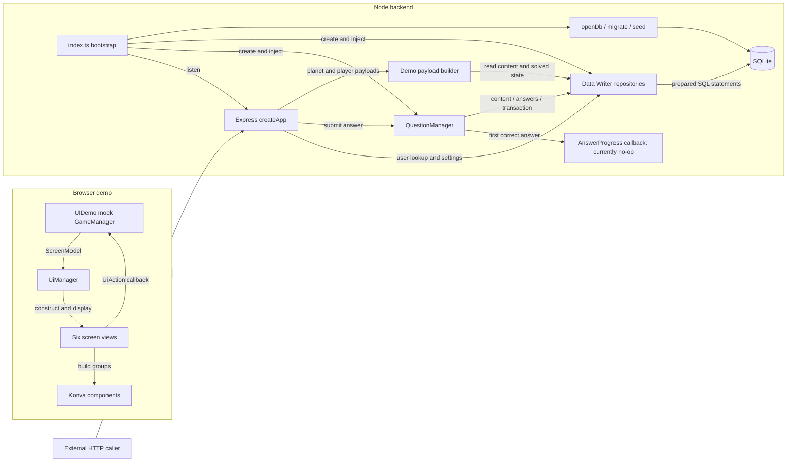
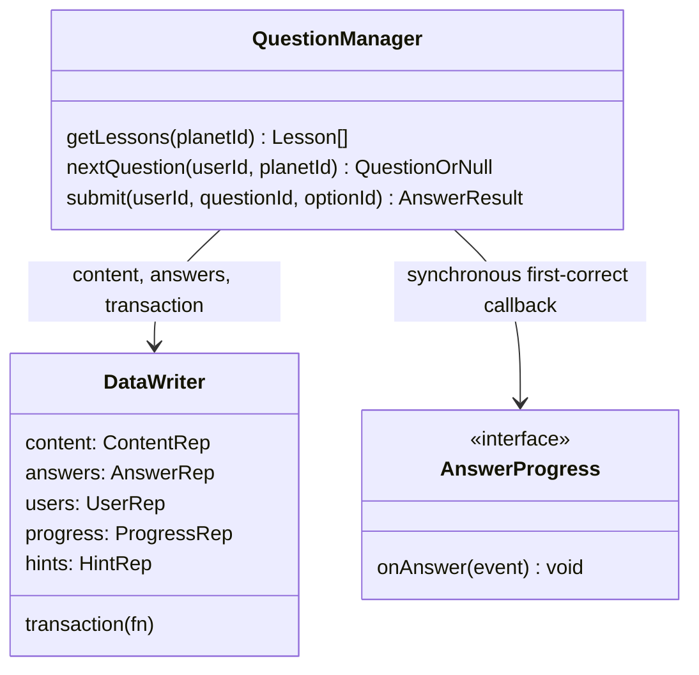
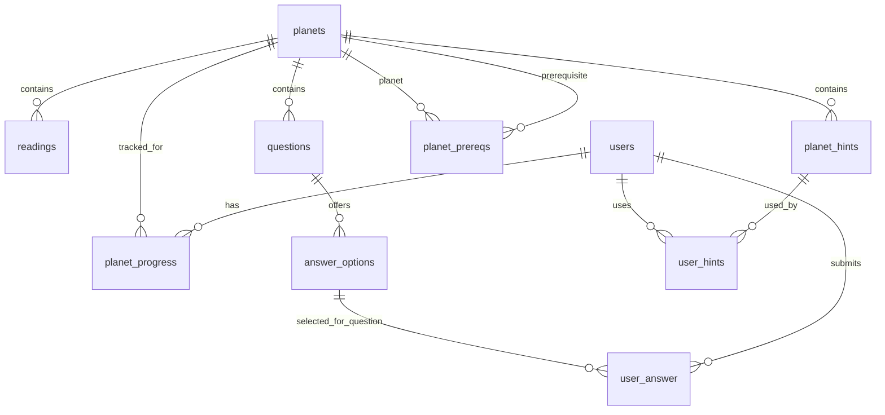

# Graphalaxy architecture

Checked against the repository on November 2, 2026. This document describes the
current implementation and identifies planned components separately. The source
files and [official migration](../server/migrations/001_schema.sql) define the
implemented contracts. See [Question Manager](QUESTION_MANAGER.md) for its public
methods, validation, and transaction behavior.

## Current implementation status

Graphalaxy is an npm-workspace project using TypeScript, Konva, Vite, Express,
SQLite through synchronous `better-sqlite3`, and Vitest. The repository contains
a working UI demonstration, database/repository services, Question Manager, and a
demo HTTP API. These are not yet one connected browser-to-database game.

| Area | Implemented | Current boundary |
| --- | --- | --- |
| UI | `UiManager`, reusable Konva components, six screen views, mock demo controller | Demo screens use fixed data and do not call the backend |
| Frontend models | JSON parsing for `Settings`, `Player`, `Planet`, `ReadingTask`, and `QuestionTask` | Models do not implement a live Session Cache or HTTP transport |
| HTTP API | User creation/lookup by username, planet payload, settings update, answer submission | Demo code; no password/session authentication or route tests |
| Question Manager | Reading pages, next unsolved MCQ, grading, safe service responses, first-correct callback | Only `submit` is currently exposed through HTTP |
| Data Writer | Users, content, answers, progress, hints, and transactions | Persists rows; does not decide game progression |
| Database | Official migration, connection helper, migration runner, seed, tests | One planet seeded with two readings, five MCQs, and three hints |
| Progress | Repository operations and `AnswerProgress` interface | Server startup supplies a no-op handler; no Progress Manager implementation |
| Other game services | Planned Game Manager/Session Cache/API Client, Profile/Hint Managers, graph renderer, minigames, navigation/settings screens | No standalone implementations of these services in the current source tree; the demo has a local mock `GameManager` |

## Repository layout

```text
client/
  index.html                   # loads the currently empty src/main.ts
  demo.html                    # loads the mock UI demonstration
  vite.config.ts               # /api proxy to localhost:3000
  src/Frontend/                # frontend types and JSON-parsing models
  src/UI/                      # UiManager, components, constants, screen views
  src/UI/test/                 # UIDemo.ts and screen-bounds tests
server/
  migrations/001_schema.sql    # official game tables and constraints
  src/index.ts                # database/bootstrap and Express listener
  src/app.ts                  # createApp and demo routes
  src/api/payloads.ts          # demo Player/Planet payload construction
  src/question-manager/       # QuestionManager, AnswerProgress, and tests
  src/data-writer/             # repository interfaces, implementations, tests
  src/db/                      # connection, migration, seed, and schema tests
shared/
  src/api.ts                  # safe QuestionManager response types
  src/index.ts                # shared package exports
.github/workflows/ci.yml       # type checking, lint, workspace tests
DOCUMENTATION/
```

There is no separate QuestionRepo or manager-owned schema. Database operations
are provided by the existing Data Writer. Static images and fonts are served
from `client/public/assets/`.

## Implemented runtime connections

The UI demo and the HTTP API are independent entry points today. There is no
implemented API Client connecting the diagram's two paths.



Rectangles denote executing modules or services; the cylinder denotes persistent
storage. Solid arrows denote existing calls, callbacks, or data flow. Bootstrapping
edges show dependency construction, not additional independent connections.

## Frontend modules

### Display and demo flow

[UiManager](../client/src/UI/UIManager.ts) owns a Konva stage and layer, adds the
background, replaces the current view, and scales/centers an 800 by 500 design
within the browser window. Each view implements `View.getGroup()` and uses
`Component`, `TextBoxComponent`, `ButtonComponent`, or `ImageComponent`.

The screen types are `title`, `intro`, `reading`, `question`, `questionResult`,
and `lessonResult`. There is no implemented `Screen`/`Frame` hierarchy from the
earlier design. The screen model union lives in
[UI/types.ts](../client/src/UI/types.ts).

The question view keeps its selected option locally, highlights the selected
button, and emits `{type: 'answer', option: 1..4}` only when Confirm is clicked
with a selection. Other actions are `start`, `next`, `back`, and `retryLesson`.
The current mock controller handles only start/next/answer/back.

[UIDemo.ts](../client/src/UI/test/UIDemo.ts) loads fonts and steps through a fixed
intro, reading, question, question result, and lesson result. Its mock
`GameManager` advances the screen index; it does not grade, submit, or calculate
the displayed score. `client/src/main.ts` is empty, so the normal index page does
not bootstrap the game yet.

### Parsing models

[SessionCacheModels.ts](../client/src/Frontend/SessionCacheModels.ts) validates
JSON and constructs `Settings`, `Player`, `Planet`, and reading/question tasks.
`Planet.tasks` is a flat ordered list. These are data models, not a Session Cache
with actions, subscriptions, retry state, or persistence.

The frontend `QuestionTask` currently requires `prompt`, string options, and a
zero-based `correct` index. Its constructor and `toType()` preserve only those
fields plus the task type; extra `questionId`, `graph`, and `solved` properties
from the demo HTTP payload are not retained.

## Backend modules and HTTP API

[index.ts](../server/src/index.ts) opens one SQLite connection, applies unapplied
migrations, seeds content if no planets exist, creates one Data Writer, constructs
Question Manager, and starts the Express app. `PORT` defaults to 3000. Its
`AnswerProgress.onAnswer` implementation currently does nothing.

[createApp](../server/src/app.ts) uses `express.json()`, validates request data,
looks up users, and handles these four routes. All return 200 on success.

| Method and path | Input | Response / implementation |
| --- | --- | --- |
| `POST /api/users` | `{username}` | Get or create user; return `PlayerPayload` |
| `GET /api/users/:userId/planets/:planetId` | Path IDs | `buildPlanetPayload` using Data Writer directly |
| `PATCH /api/users/:userId/settings` | `{musicVolume, sfxVolume}` | Save volumes; return updated `PlayerPayload` |
| `POST /api/users/:userId/questions/:questionId/answer` | `{optionId}` | `QuestionManager.submit`; return shared `AnswerResult` |

The answer path is singular `/answer`. There are no HTTP routes for Question
Manager's reading/next-question methods, planet lists, hints, minigame results,
or progress summaries yet.

Username input is trimmed and must contain 1 to 32 characters. Audio volumes
must be numbers from 0 to 1. User IDs in existing-user routes must resolve to a
stored user. This is username-based demo identity, not password or session
authentication; providing an existing user ID selects that user's data.

Handled route errors use `{error: {code, message}}`. Question Manager input and
not-found errors map to 400 and 404; its other codes map to 500. Malformed JSON
and other Express 4xx parsing errors become `INVALID_INPUT`; unexpected failures
use `INTERNAL` with a generic message. Internal causes are logged rather than
included in responses. No custom unmatched-route response is installed.

### Data contracts: service, demo API, and UI

These formats are separate in the current codebase:

| Contract | Options | Correctness | Graph / identity |
| --- | --- | --- | --- |
| Shared `Question` from Question Manager | Objects with `optionId`, `label`, `text` | No answer key before submission | `questionId`; optional stored graph string |
| Demo `QuestionTaskPayload` | `string[]` | Includes zero-based `correct` index before submission | `questionId`, optional parsed graph object, `solved`; no option IDs |
| Frontend `QuestionTask` model | `string[]` | Requires `correct` | Extra graph/question/solved fields are discarded |
| UI question screen model | Four strings: `option1` through `option4` | No grading field in the screen model | Emits button positions 1 through 4 |

[api/payloads.ts](../server/src/api/payloads.ts) maps users to
`{userId, name, hintQuota, settings}` and builds a planet with metadata and
`tasks`: all readings in reading order, then MCQs in question order. Non-MCQs are
skipped. Solved questions stay in the list with per-user flags. Graph JSON must
parse to a non-null, non-array object or the builder throws `INVALID_CONTENT`.

**The demo planet GET response exposes the correct answer index.** It bypasses
Question Manager's safe retrieval methods to satisfy the current frontend model.
The service's safe-serialization tests therefore do not guarantee answer privacy
for that endpoint. There is no implemented frontend HTTP client using either
contract yet. An adapter must preserve database IDs, map button positions to
option IDs, and use submitted server feedback to complete the intended flow.

## Question Manager and Data Writer

Question Manager maps ordered readings to legacy `Lesson` display wrappers,
selects the next unsolved question, and grades MCQs. Readings and questions are
independent planet content; no lesson-to-question association is synthesized.
Only answer submission currently passes through this service in the HTTP app.

The Data Writer exposes five repositories and a synchronous transaction wrapper:

| Repository | Responsibility |
| --- | --- |
| `users: UserRep` | User lookup/creation, audio settings, spending/adding hint quota |
| `content: ContentRep` | Planets, prerequisite edges, readings, questions, public options, server-side grading options |
| `answers: AnswerRep` | Correct-completion lookup and attempt inserts including selected option IDs |
| `progress: ProgressRep` | Ensure/list progress rows, increment count, set status |
| `hints: HintRep` | List planet hints with per-user usage and mark a hint used |

Interfaces and stored row types live in
[repository.ts](../server/src/data-writer/repository.ts). Implementations are
`SqliteUserRep`, `SqliteContentRep`, `SqliteAnswerRep`, `SqliteProgressRep`, and
`SqliteHintRep` in
[repository-impl.ts](../server/src/data-writer/repository-impl.ts). They prepare
statements once per instance and alias database column names to camelCase.



This module diagram shows declared dependencies. An arrow does not imply that a
full Progress Manager is implemented. There is no separate `Grader` class; MCQ
grading is implemented by Question Manager.

### Answer and progress transaction

`DataWriter.transaction(fn)` calls `db.transaction(fn)()` on the shared connection.
It commits on return and rolls back on throw, using SQLite's default transaction
mode. Nested calls use savepoints; the wrapper does not request `BEGIN IMMEDIATE`.

Question Manager validates content/option ownership, checks prior completion,
records an attempt, and invokes its first-correct callback within that boundary.
Repeated correct answers return feedback without another insert; wrong attempts
are appended, even after completion. The callback must be synchronous and use
the same connection for progress writes to participate in rollback.

The current startup callback is a no-op, so even HTTP answer submissions do not
update counts/status. Recording a correct answer through `AnswerRep` also does
not automatically update progress. Similarly, hint quota and hint usage are
separate operations; no Hint Manager currently pairs them into a gameplay action.

## Official database model

The migration creates ten game tables. `migrate()` separately creates
`schema_migrations` to track applied filenames. All connections created by
`openDb()` enable foreign keys.

| Table | Columns |
| --- | --- |
| `users` | `user_id`, `username`, `hint_quota`, `music_volume`, `sfx_volume`, `date_of_creation` |
| `planets` | `planet_id`, `name`, `intro_text`, `graph_order` |
| `planet_prereqs` | `planet_id`, `prereq_planet_id` |
| `readings` | `reading_id`, `planet_id`, `reading_number`, `text` |
| `questions` | `question_id`, `planet_id`, `prompt`, `qtype`, `graph` |
| `answer_options` | `option_id`, `question_id`, `label`, `text`, `is_correct` |
| `planet_hints` | `hint_id`, `planet_id`, `hint_number`, `text` |
| `user_hints` | `user_id`, `hint_id` |
| `user_answer` | `answer_id`, `user_id`, `question_id`, `selected_option_id`, `correct`, `answered_at` |
| `planet_progress` | `user_id`, `planet_id`, `status`, `correct_count` |
| `schema_migrations` | `filename`, `applied_at` (migration-runner metadata) |



`||` denotes one parent and `o{` zero or more child rows. Each relationship
corresponds to a foreign key. The answer-option relationship uses the composite
key `(question_id, selected_option_id)` referencing
`answer_options(question_id, option_id)`.

Important constraints and ownership:

- Reading numbers and hint numbers are unique within a planet. The introduction
  is stored in `planets.intro_text`. There is no `lessons` table, question order
  column, reading-question junction, slider-ranges table, or resume/snapshot field.
- Questions permit `mcq` or `free_response` at the schema level; only MCQs have
  implemented grading. `graph` is nullable text; JSON parsing is a consumer rule,
  not a database constraint.
- Option labels are restricted to `a`, `b`, `c`, `d` and unique per question.
  `uq_one_correct_option` enforces at most one correct option; the service checks
  that there is a valid one before grading/returning an MCQ.
- Attempts require a selected option from the same question.
  `uq_one_correct_answer` permits at most one correct row per user/question;
  repeated wrong rows are allowed.
- Progress and used-hint rows have composite user/content keys. Repository
  methods store data; prerequisite unlocking, hint-award rules, and peaceful
  thresholds are not implemented game services yet.
- Content is authored by the migration/seed tools. Runtime writes are user
  creation/settings, attempts, and explicitly requested progress/hint operations.
  The current app does not use the progress or hint repository operations.

## Startup, configuration, and checks

Use the Node 22 major version in `.nvmrc`; the package requires Node >=22.22.2.
Install from the repository root with `npm ci`. Run the backend and UI demo in
separate terminals:

```bash
npm run dev -w server
npm run dev:demo -w client
```

The backend defaults to `http://localhost:3000`; Vite normally serves
`http://localhost:5173/demo.html`. The Vite `/api` proxy targets port 3000, so a
custom server `PORT` also requires a corresponding proxy change. The proxy
configuration does not itself make the mock demo issue requests.

`npm run start -w server` runs the backend without watch mode. `DB_PATH` overrides
the default `server/var/game.db`; `openDb(':memory:')` is used for isolated tests.
The database, `server/var/`, build output, and `.env` are ignored by Git.

The migration runner applies new SQL files in filename order, recording each in
the same transaction as its schema changes. The seed inserts Linear Land only
when the planets table is empty. Database scripts are `db:migrate` and `db:seed`
in the server workspace; resetting the database is not required for normal startup.

TypeScript uses `module: ESNext`, `moduleResolution: Bundler`, DOM libraries,
`esModuleInterop`, and `skipLibCheck`. Runtime scripts use `tsx` for server source
and Vite for browser source. No production deployment configuration is present.

```bash
npm run compile
npm run lint
npm test
```

Root `npm test` compiles, lints, runs workspace tests, and lints again. CI performs
type checking, linting, and workspace tests on pull requests and pushes to main.
Git hooks run ESLint fixes on staged source and enforce Conventional Commits.

The current test suites total 200 cases: 84 client and 116 server, including 47
Question Manager cases. Client tests cover model parsing and screen geometry;
server tests cover the schema/seed, repositories/transactions, and Question Manager.
The geometry tests do not prove canvas rendering or browser behavior. HTTP routes,
demo payloads, and browser-to-database integration have no committed test suites.

## Remaining integration work

1. Connect a real frontend controller/Session Cache and API Client to the backend;
   initialize the normal client entry point and preserve question/option IDs.
2. Agree on one public question contract and remove the demo GET response's
   pre-submission answer index. Expose safe reading/next-question operations as
   needed and consume submission feedback in the UI.
3. Supply a real synchronous progress handler and implement counts, completion
   thresholds, and prerequisite/unlock summaries. Existing correct attempts will
   need reconciliation if progress updates are added after those attempts exist.
4. Implement profile/authentication, hint quota/usage workflows, graph rendering,
   navigation/settings screens, and the two minigames as their sprint scopes allow.
5. Add route/payload tests and a complete browser-to-database demo test.

These are planned changes, not behaviors provided by the current code.
